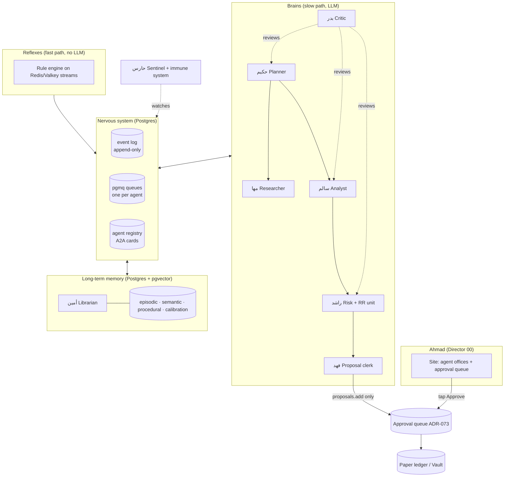
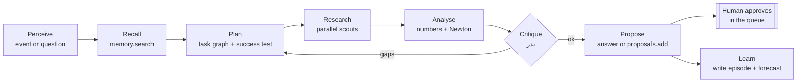
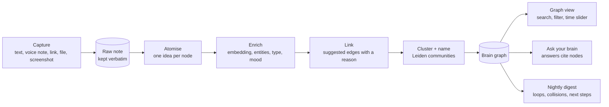

# OMEGA / NABD agent system: brains, nervous system, long-term memory

Status: **design only (ADR-077; second brain ADR-078)**. No agent, bus, memory table or UI in this document is built yet. Building starts
one phase at a time after Ahmad approves each phase. Date: 2026-10-16.

---

## الملخص بالعربي

**الفكرة:** شركة صغيرة من وكلاء ذكاء اصطناعي، لكل وكيل وظيفة واحدة ومكتب (صفحة في الموقع) وأدوات محددة وجهاز
خاص (حاوية معزولة). كلهم مربوطون بـ«جهاز عصبي» واحد، وعندهم «ذاكرة طويلة» مشتركة لا تنسى، و«عقل» يفكر ويبحث
ويخطط ثم يقترح. التنفيذ الوحيد المسموح هو **إضافة مقترح إلى طابور الموافقة**، وأنت من يضغط «موافقة».

**الأدمغة (طبقتان مثل الإنسان):**
- **ردود فعل سريعة** بلا ذكاء اصطناعي: قواعد ثابتة تشتغل في أجزاء من الثانية (مثلاً: سعر نزل 5% ← تنبيه).
- **تفكير عميق**: حلقة «افهم ← خطط ← ابحث ← حلّل ← انتقد نفسك ← اقترح ← تعلّم»، على النماذج المجانية أولاً
  (بوابة Cortex الموجودة) ثم Qwen المحلي.

**الجهاز العصبي:** سجل أحداث واحد لا يُمحى (كل شيء يحصل يُكتب فيه: من، متى، ماذا، ولماذا)، وطوابير رسائل بين
الوكلاء داخل Postgres الموجود عندك، بدون سيرفر جديد. ولكل وكيل «بطاقة هوية» تقول مكانه وما يقدر وما لا يقدر.

**الذاكرة الطويلة (4 أنواع):** ذاكرة عمل (المهمة الحالية)، ذاكرة أحداث (ماذا حصل)، ذاكرة معرفة (حقائق مع تاريخ
صلاحيتها ومصدرها)، وذاكرة مهارات (طرق نجحت). كل ليلة «نوم» يرتّب الذاكرة: يلخّص، يحذف المكرر، ويكشف التناقض.
وكل توقع يقوله وكيل يُسجَّل ويُحاسَب عليه لاحقاً، فيتعلم النظام من أخطائه ويعرف أي وكيل يُصدَّق أكثر.

**الوكلاء:** حكيم (المخطط والمنسق)، مها (البحث العميق)، أمين (حارس الذاكرة)، سالم (محلل السوق)، راشد (المخاطر +
وحدة RR)، فهد (يجهّز المقترحات فقط)، نورة (شرح للمبتدئين)، بدر (الناقد والمدقق)، حارس (صحة النظام والأمان)،
خازن (الخزينة الورقية). كل واحد يقول في أول كلامه إنه وكيل ذكاء اصطناعي.

**العقل الثاني (جديد):** كل فكرة تكتبها أو تقولها أو تلصقها تُحفظ كما هي، ثم يقطّعها أمين إلى أفكار صغيرة ويربطها
ببعض (تشبه، تدعم، تناقض، تؤدي إلى مهمة) ويجمعها في مجموعات بأسماء. تظهر كلها في **خريطة تفاعلية مثل الصورة**:
بحث، فلترة بالنوع والتاريخ والمجموعة، شريط زمني تشوف فيه عقلك يكبر، ووضع ثلاثي الأبعاد بشكل «الكوكبة العصبية».
الروابط التي يقترحها الذكاء الاصطناعي تظهر منقطة حتى تقبلها أنت. وفيه أدوات لزحمة التفكير: «فرّغ راسك» يرتب أفكارك
في مجموعات مع 3 خطوات تالية فقط، وكشف الأفكار التي تدور في حلقة بلا تقدم، و«تصادم» يومي يربط فكرتين بعيدتين لتوليد
فكرة جديدة. أفكارك **خاصة**: تُعالج بالنموذج المحلي على جهازك، ولا تُرسل لأي خدمة سحابية إلا فكرة تسمح بها أنت،
ولا يتحول شيء منها إلى مقترح تداول. وتُصدَّر كل ليلة كملفات Markdown تفتحها في Obsidian أو Logseq، فلا تُحبس عندنا.

**المحفظة ووحدة RR و«نظام البنك السويسري»:** تصميم **ورقي وقراءة فقط**: دفتر قيد مزدوج لا يُمحى، مبدأ «العينين
الأربع» (من يقترح غير من يوافق)، فصل الحسابات، ومطابقة يومية. **هذا ليس بنكاً**، لا يحفظ أموالاً ولا يحرّكها ولا
يحمل مفاتيح منصات. أي استخدام حقيقي يحتاج مراجعة ترخيص أولاً (هيئة أسواق المال والبنك المركزي في الكويت، و FINMA
في سويسرا). أسئلة المحامي في `launch-drafts/LAWYER-QUESTIONS.md`.

**وحدة RR** (فهمتها «المخاطرة إلى العائد»، قل لي إذا قصدت شيئاً آخر): لكل مقترح نقطة دخول ووقف خسارة وهدف، ونسبة
عائد إلى مخاطرة لا تقل عن 2، وحجم داخل حد 50 إلى 200 USDT، وإلا يُرفض المقترح قبل أن يصلك.

**البحث:** فحصت 91 مشروعاً مفتوح المصدر (59 للوكلاء و32 للعقل الثاني والخرائط) من مستودعاتها الرسمية (الترخيص وتاريخ آخر تحديث، 2026-10-16). الاختيار:
LangGraph للعقل، Postgres + pgvector + pgmq للجهاز العصبي والذاكرة، MCP للأدوات، بطاقات A2A للهويات، و TigerBeetle
لاحقاً للدفتر الورقي. واستبعدت ما ليس مفتوح المصدر فعلاً (Restate بترخيص BSL، و Phoenix بترخيص Elastic) وما توقف
تطويره (AutoGen). وتنبيه: Redis 7.4 الموجود عندك لم يعد بترخيص مفتوح، والبديل المجاني المطابق هو Valkey.

**الخطة:** 7 مراحل (العقل الثاني هو السابعة، ويمكن تقديمه بعد مرحلة الذاكرة)، كل مرحلة تنتظر موافقتك. الأولى (الجهاز العصبي) لا تحتاج أي ذكاء اصطناعي ولا مفاتيح، وتكلف
تقريباً 0 ذاكرة إضافية لأنها داخل Postgres الموجود.

---

## 1. Ground rules (non-negotiable, carried from ADR-073 and ADR-076)

1. **No real money.** No custody, no exchange or broker keys, no orders, no withdrawals, no transfers. The only
   "write" any agent has on the money side is `proposals.add` into the existing approval queue (ADR-073).
2. **A human approves every proposal.** `approveAndRecord` stays the only code path to a paper fill. No agent, rule or
   schedule can call it. Agents may recommend; they cannot approve or reject for the user.
3. **Every action is audited.** Proposals, decisions and rejections already land in `paper/audit.jsonl` (ADR-076). The
   nervous system below adds the same for every agent step, append-only.
4. **AI disclosure.** Every agent opens every conversation with its disclosure line from `docs/AGENT-DISCLOSURE.md`
   and repeats it when asked. The fixed banner stays above every chat. No human backstory, photo or licence claim.
5. **Evidence or silence.** Every claim an agent makes carries a link to its raw evidence (source URL, globe point,
   data row). A claim without evidence is shown as "unverified", never as fact.
6. **Not a bank.** The Vault (section 9) is a paper and read-only ledger. It cannot hold, receive or move funds.
7. **Untrusted input cannot act.** Text fetched from the web, files, emails or other agents' outputs is data. It can
   never trigger a tool call by itself (section 7, "immune system").

## 2. Shape of the system



Two loops, like a body:

- **Reflex arc (fast, cheap, deterministic).** Market ticks, AIS, World Pulse events flow on the existing Redis
  stream bus (`services/maritime-agent/bus.py`). Plain rules (thresholds, z-scores, the existing anomaly scorer) fire
  in milliseconds and emit `signal.*` events. No LLM, no cost, no hallucination.
- **Deliberation loop (slow, smart).** A signal, a schedule or a question from Ahmad wakes the planner, which runs the
  brain loop (section 4) across the specialist agents and ends in either an answer with evidence or a proposal in the
  queue.

## 3. The agents

Every agent has: an **office** (its own page on the site, `/agents/<id>`, showing its current task, its last 20
events, its memory slice and its calibration score), a **toolbelt** (an MCP allow-list; anything not on it is refused
by the tool gateway, not by the prompt), a **computer** (its own container with CPU/RAM caps, read-only root, and its
own network policy) and an **identity card** (an A2A-style Agent Card in the registry stating what it can and cannot
do). The existing four agents keep the names and profiles in `docs/AGENTS-PROFILES.md`.

| Agent | Role | Toolbelt (MCP allow-list) | Computer (container, network) | Cannot |
|---|---|---|---|---|
| **حكيم** Hakeem, planner | Turns a goal into a plan (task graph), assigns steps, merges results, decides "done" | `registry.read`, `queue.send`, `memory.search`, `events.read` | `agent-core`, no internet | Call any market or money tool |
| **مها** Maha, researcher | Deep research: search, read, cross-check, cite | `searxng.search`, `deep_research.run`, `web.read` (text only), `memory.search` | `agent-research`, egress to an allow-list of public sources only | Act on what it reads; fetched text is tainted |
| **أمين** Ameen, librarian | Writes, merges, dates and forgets memories; runs the nightly "sleep" | `memory.*` (only writer of semantic memory) | `agent-core`, no internet | Delete the event log; it only marks memories superseded |
| **سالم** Salem, analyst | Reads signals and strategies; explains with numbers | `strategies.read`, `market.read`, `newton.*`, `worldpulse.read` | `agent-core`, no internet (data via local APIs) | Add proposals; state forecasts as facts |
| **راشد** Rashid, risk + RR unit | Checks every draft proposal: R:R, size band, concentration, drawdown, correlation | `risk.check`, `rr.compute`, `paper.read` | `agent-quant`, no internet | Approve or reject for the user; change limits |
| **فهد** Fahd, proposal clerk | Packs an analysed, risk-checked idea into a proposal with evidence | `proposals.add`, `proposals.read` | `agent-core`, no internet | Call `approveAndRecord` or any fill; there is no such tool in its belt |
| **نورة** Noura, guide | Explains screens and terms to beginners | `docs.read`, `glossary.read` | `agent-core`, no internet | Say "you should buy/sell" |
| **بدر** Badr, critic/auditor | Red-teams plans and answers: missing evidence, contradictions, injection, cost | `events.read`, `memory.search`, `evidence.verify` | `agent-core`, no internet | Change anything; it only comments and can block a step |
| **حارس** Haris, sentinel + immune | Service health (today's Sentinel), injection and anomaly watch on the bus, kill-switch | `health.read`, `events.read`, `agents.pause` | `agent-core` | Un-pause an agent; only Ahmad can |
| **خازن** Khazen, vault keeper | Keeps the paper Vault balanced: double entry, daily reconciliation, reports | `vault.read`, `vault.reconcile` | `agent-quant`, no internet | Create money, post entries outside an approved fill |

The existing workforce agents (Sentinel, Analyst, Scout in `services/agents/workforce.py`) and the six-step Brain
(`services/agents/brain.py`) become the first members: Sentinel → حارس, Analyst → سالم's background brief, Scout →
a skill of مها, and the Brain's Planner/Researcher/Designer/Critic/Synthesizer steps map onto حكيم/مها/بدر.

## 4. The brain loop

One loop, used by every deliberating agent. It is a LangGraph state graph with a Postgres checkpointer, so every
step survives a laptop restart and can pause for a human.



- **Plan** writes an explicit success test ("done when: three independent sources agree, or report disagreement").
- **Research** fans out to scouts in parallel (SearXNG, Wikipedia, OpenAlex, arXiv, GDELT: the keyless set already in
  the deep-research engine, ADR-050) and merges with reciprocal rank fusion, as today.
- **Critique** is a separate agent with a separate prompt (بدر), not self-review, and it may send the plan back at
  most twice (a budget, so the loop always ends).
- **Budgets on every run:** max steps, max tokens, max wall time, max free-tier calls. A run that hits a budget stops
  and reports what it has, marked incomplete.
- **Models:** Cortex routes as decided in ADR-050 and the Oracle free council: open-weight free tiers first, local
  Qwen 2.5 3B as the always-available fallback. Small deterministic jobs (classification, extraction) go to the local
  model; only planning and critique use the larger free models.

## 5. Nervous system: events, queues, registry

Decision: **build it inside the Postgres you already run**, no new server. NATS JetStream is the upgrade path when one
laptop is not enough.

**Event log** (`nerve.events`, TimescaleDB hypertable, append-only, revoked UPDATE/DELETE grants):

```text
id uuid · ts timestamptz · agent text · kind text (signal.* | task.* | tool.call | tool.result | memory.* |
proposal.* | human.* | guard.*) · run_id uuid · parent_id uuid · trust text (owner | system | agent | tainted) ·
payload jsonb · evidence jsonb[] · hash text (sha256 of previous hash + row: a hash chain, so tampering shows)
```

Every step of every agent writes here. The office pages, the audit view and the nightly sleep all read from it. It is
the single source of "what happened and why".

**Queues** (`pgmq`, PostgreSQL licence): one queue per agent (`q_hakeem`, `q_maha`, ...). A message is a task with
`run_id`, `deadline`, `budget` and `reply_to`. Visibility timeouts give at-least-once delivery; handlers are
idempotent on `(run_id, step)`. Postgres `LISTEN/NOTIFY` wakes the worker so nothing polls.

**Fast lane:** the existing Redis Streams bus stays for high-rate data (AIS, ticks) with Arrow batches. Licence note:
`redis:7.4-alpine` in `docker-compose.yml` is under RSALv2/SSPL (not OSI open source); **Valkey** (BSD-3, same
protocol and commands) is a drop-in swap and is proposed in phase 1.

**Registry** (`nerve.agents`): one row per agent holding its A2A-style Agent Card: id, name, disclosure line, role,
skills, tool allow-list, queue name, container, owner, status (active / paused). Agents find each other only through
the registry ("who can do `risk.check`?"), which is how "each one knows its place".

**Tool gateway:** all tools are MCP servers behind one gateway that checks the caller's allow-list from the registry,
the trust level of the input, and the run's budget, and writes `tool.call` / `tool.result` events. Permissions live in
data, not in prompts, so a jailbroken prompt still cannot reach a tool it was never given.

## 6. Long-term memory ("forget nothing", done safely)

Stored in the existing `memory` service (Postgres 17 + pgvector 0.8). Embeddings from a small local multilingual
model (Arabic + English) via Ollama, so memory never leaves the laptop.

| Tier | What | Written by | Lifetime |
|---|---|---|---|
| Working | Current run's state | LangGraph checkpointer | Run |
| Episodic | What happened: compressed runs, conversations, outcomes | Any agent, via أمين | Kept; summarised after 30 days |
| Semantic | Facts and beliefs with **valid_from / valid_to**, source, confidence | أمين only | Until superseded (never hard-deleted; marked `superseded_by`) |
| Procedural | Skills that worked: plans, prompts, checklists, with success counts | أمين after بدر's review | Kept while success rate holds |
| Calibration | Every forecast an agent made, then its real outcome and Brier score | System at resolve time | Permanent |

- **Bitemporal facts** (idea from Graphiti): a fact has when it was true and when we learned it, so the system can
  answer "what did we believe on 10 Oct and why" and never silently overwrites history.
- **Retrieval** is hybrid: pgvector similarity + Postgres full-text (Arabic and English) + recency + source trust,
  merged with reciprocal rank fusion (the same method the deep-research engine uses).
- **Write gate:** a memory is written only with its evidence link and the run that produced it. Memories derived from
  tainted input are stored as `unverified` until a second independent source confirms them.
- **Privacy:** per-user memories are separated by user id; a user can list and delete their own (rule from
  `AGENTS-PROFILES.md`). Secrets are never written to memory; the write path rejects key-shaped strings.

## 7. Out-of-the-box ideas (each one small and testable)

1. **Sleep cycle.** Every night أمين replays the day's event log: compresses episodes, promotes repeated facts to
   semantic memory, merges duplicates, flags contradictions for بدر, and writes a one-page "what I learned today".
2. **Calibration ledger (the system knows how good it is).** Every forecast ("BTC above X in 7 days, 60%") is stored
   and scored when it resolves. Each agent's Brier score is shown in its office and weights its voice in the planner.
   An agent that keeps being wrong is quieter by design. This is also the honest answer to "is it working?".
3. **Surprise drives attention.** The reflex layer compares what memory expected with what arrived; a large surprise
   (a fact contradicting a high-confidence belief) wakes the deliberation loop. Quiet days cost almost nothing.
4. **Immune system.** Every piece of content carries a trust label (`owner`, `system`, `agent`, `tainted`). Tainted
   text can be read and quoted but cannot become a tool argument for a write tool. حارس scans the bus for known
   injection patterns and can pause any agent (only Ahmad can resume it).
5. **Blackboard (global workspace).** The planner posts the current goal and open questions to one shared board in
   the event log; agents volunteer by skill instead of being hard-wired, so new agents plug in without rewiring.
6. **Two-key proposals.** A proposal needs two agents (سالم's analysis + راشد's risk pass) before فهد may queue it,
   then Ahmad's tap. Three keys in total, two machine and one human.

## 8. Wallet (المحفظة) and the RR unit

**Wallet view (read-only):** one screen that sums the paper account (ADR-044 ledger), open paper positions, pending
proposals and realised paper P&L, with every number linked to its ledger lines. Optional later: watch-only public
addresses (public chain data, no keys, no signing), only if Ahmad asks.

**RR unit (inside راشد).** Interpreted as risk/reward; inferred from the request. For every draft proposal:

- Requires entry, stop and target; computes R = entry − stop and the reward/risk ratio. Default minimum **2.0**.
- Size stays inside the existing **50 to 200 USDT** band (ADR-074); size = min(band max, risk budget / R).
- Portfolio checks: concentration per asset, correlation to open positions, current paper drawdown, losing streak.
- Output is a risk card attached to the proposal (numbers + pass/fail per rule). A failed card means فهد cannot queue
  it; Ahmad sees why in the audit log.
- Libraries: Riskfolio-Lib (BSD-3) and PyPortfolioOpt (MIT) for portfolio risk, QuantStats (Apache-2.0) for paper
  performance reports. All offline, no keys.

## 9. "Swiss-style" Vault (paper only; not a bank)

> **This is not a bank.** The Vault cannot hold, receive, send or move funds, has no exchange or bank connection, and
> holds no keys. It is a paper ledger and a set of controls modelled on how well-run banks keep books. Any use with
> real money or for other people needs a licence review first: in Kuwait the Capital Markets Authority (Law No. 7 of
> 2010) and possibly the Central Bank of Kuwait; in Switzerland, banking activity requires FINMA authorisation. The
> open questions are in `launch-drafts/LAWYER-QUESTIONS.md`; sending them is Ahmad's action.

What "Swiss-style" means here, all on paper:

- **Double-entry, immutable ledger.** Every paper movement is a balanced pair of entries; no edits, only reversing
  entries. Phase 6a uses Postgres tables with a balance check; TigerBeetle (Apache-2.0, built for double-entry
  financial accounting) is the upgrade if volume ever needs it.
- **Four-eyes (maker-checker).** The agent that prepares an entry can never be the one that approves it; approval is
  always Ahmad's tap (ADR-073).
- **Segregation of accounts.** Each paper strategy and each user has its own sub-ledger; no paper money crosses
  between them without a recorded transfer.
- **Daily reconciliation.** خازن recomputes every balance from the entries and from the paper ledger and reports any
  difference to Ahmad; a difference freezes new proposals until resolved.
- **Statements.** A monthly paper statement per account, generated from the ledger, every line traceable.

## 10. Computers for each agent

- Each agent runs in its own container on the existing hardening anchor (`cap_drop: ALL`, read-only root, non-root
  user, `mem_limit`, `cpus`, `pids_limit`), like `services/agents` today.
- Three images, not ten, to save RAM: `agent-core` (most agents, no internet), `agent-research` (egress allow-list),
  `agent-quant` (Python with the risk libraries). Agents sharing an image are separate processes with separate queues.
- A browser for research (browser-use / Playwright) runs only on demand in a throw-away container with no access to
  the core network, and only reads public pages. No CAPTCHA solving or anti-bot bypass (standing decision).
- Code-writing agents (OpenHands, E2B) are out of scope for now: the brain proposes changes; humans and the existing
  thread workflow make them.

## 11. Resource budget on the 7 GB laptop (estimates)

| Piece | Extra RAM (estimate) | Note |
|---|---|---|
| Event log + queues + registry | ~0 | Tables in the existing Timescale/Postgres |
| Memory tiers | ~0 to 50 MB | Existing `memory` pgvector service |
| Agent runtime (3 containers) | ~300 MB | Python + LangGraph; idle agents sleep on LISTEN |
| Local embeddings | ~300 to 600 MB while running | Loaded on demand by Ollama, unloaded after |
| Valkey instead of Redis | ±0 | Same footprint |

LLM thinking stays on free cloud tiers through Cortex with the local model as fallback, so no new GPU or paid key is
needed. Exact numbers get measured in phase 1 and replace these estimates.

## 12. Second brain (العقل الثاني)

Ahmad's brief (2026-10-16): someone who overthinks gets a million ideas a day; the AI should not only file them but
rescue him from the crowd of thoughts, link them, and, the more he feeds it, become a second mind that thinks with
him. The answer is a personal knowledge graph that the agents build and query, shown as an interactive map like the
graph view in his screenshot.

### 12.1 How a thought travels



1. **Capture anywhere, zero friction.** One box on the site and on the phone home screen (paste, type, share a link
   or screenshot). Voice notes are transcribed on the laptop later (local speech-to-text; no cloud). Nothing is asked
   at capture time: no folder, no tag, no title.
2. **Raw is sacred.** The original text is stored verbatim with its time and source and is never edited by an agent.
   Everything else is derived and can be rebuilt.
3. **Atomise.** أمين splits a dump into atomic ideas (one claim, question, task or feeling per node), each pointing
   back to the raw note it came from.
4. **Enrich.** Each node gets a local embedding, the entities it mentions (people, places, assets, projects), a type
   (idea, question, task, fact, worry, decision, quote, source) and a time.
5. **Link, with reasons.** Candidate edges come from four signals: explicit `[[links]]` he typed, semantic
   similarity (pgvector k-nearest neighbours above a threshold), shared entities, and closeness in time. The local
   model labels the strongest candidates: `similar_to`, `supports`, `contradicts`, `leads_to` (idea → task),
   `part_of`, `answers` (fact → question), `derived_from`. Every machine edge stores its confidence and a one-line
   "why".
6. **Cluster and name.** Leiden community detection groups the graph into themes; the local model names each theme
   in Arabic. Clusters are recomputed nightly, so themes appear, merge and split as his thinking changes.

**He stays the owner of his own mind.** Edges he typed are solid. Machine edges show dashed until he taps accept or
reject; every accept or reject tunes the thresholds (more accepted `similar_to` → lower threshold), so the linker
learns his taste.

### 12.2 Rescue from overthinking (the features that matter)

- **Brain dump.** He pours out everything in one go; he gets back the dump grouped into 3 to 7 themes, the open
  questions, at most 3 next actions, and a "parked" list for the rest. Nothing is lost; the noise is just sorted.
- **Loop detector.** The same idea or worry recurring (high similarity across days) with no new edge, task or decision
  is a loop. The digest names it gently: "you came back to X five times this week; here are the three versions; one
  question would settle it".
- **Worry → question.** A node typed `worry` gets a suggested rewrite as a concrete question that research (مها) or a
  decision can answer.
- **Daily collision (serendipity).** Once a day, a random walk picks two distant nodes from different clusters with a
  plausible bridge and asks "what if these connect?". This is the out-of-the-box engine: new ideas come from
  unexpected links, not from more of the same.
- **Contradiction alarm.** A new node that contradicts an older high-confidence one is flagged with both sides and
  their dates, instead of silently replacing it.
- **Decision journal.** A `decision` node records what he expected; it links to the calibration ledger (section 7),
  so later he sees how his own predictions turned out.
- **Think with me.** A chat mode where حكيم answers only from his own graph (plus research on request), cites the
  nodes it used, highlights the path on the map, and asks the next question instead of lecturing.

### 12.3 Graph view (the map in his screenshot)

- **Engine:** sigma.js (WebGL) on graphology for the 2D map; it renders thousands of nodes smoothly, and layout
  (ForceAtlas2) and Leiden clustering run in a web worker so the page never freezes. A **3D "neural constellation"
  mode** with 3d-force-graph matches the dark neural style of the site (the existing constellation demo).
- **Look:** dark background; node colour = cluster, size = how connected it is, ring = type; solid edges are his,
  dashed are suggestions, red for `contradicts`. Labels appear on zoom (level of detail), so the phone shows themes
  first and ideas as you zoom in.
- **Search:** one box, both exact (Arabic and English full text) and by meaning (embedding). Results light up on the
  map and the camera flies to them.
- **Filters:** by type, cluster, date range, source, edge type, confidence, and "only mine / include suggestions".
- **Time slider:** replay the graph growing day by day; see when a theme was born.
- **Focus and path:** click a node to show its neighbourhood (1 to 3 hops) and a side panel with the raw text, its
  sources and its links (accept / reject buttons); pick two nodes to see the shortest path between them.
- **Every node opens its evidence:** the raw note, the link, the screenshot or the source page, in line with the
  "see it with my own eyes" rule.

### 12.4 Storage and privacy

- **Tables** in the existing `memory` Postgres: `brain.raw` (verbatim captures), `brain.nodes` (atoms, type,
  embedding, cluster, entities), `brain.edges` (from, to, type, origin `human|machine`, confidence, why, state
  `suggested|accepted|rejected`). Neighbourhood and path queries use recursive SQL; Apache AGE (Apache-2.0, Cypher
  inside Postgres) is the option if graph queries grow, with no new server.
- **Two separate graphs.** His second brain is private and separate from the agents' system memory (section 6).
  Agents can read it only with the `brain.read` permission, only أمين writes suggested edges, and nothing in it can
  become a trading proposal.
- **Local by default.** Personal notes are processed by the local model (Qwen via Ollama) on his laptop. A note is
  sent to a cloud model only if he marks that note "ok for cloud", and then only to providers that do not train on
  prompts (the `x-omega-private` rule in Cortex). Secrets pasted by mistake are detected and refused before storage.
- **No lock-in.** Every night the graph is exported as a folder of Markdown files with `[[wikilinks]]` and front
  matter, readable in Obsidian, Logseq or Foam. If OMEGA disappeared tomorrow, his brain would still be his.
- **Cost:** the map runs in the browser; heavy work (atomise, link, cluster, name) runs in a nightly batch on the
  local model, plus a quick pass on capture. No new server, no paid key.

## 13. Phases (each waits for Ahmad's go)

| Phase | Builds | Needs from Ahmad |
|---|---|---|
| 1 Nervous system | `nerve.events` (hash chain), pgmq queues, registry with Agent Cards, tool gateway skeleton, Valkey swap, office page that shows the event stream | Nothing (no keys, no LLM) |
| 2 Memory | Tiers + hybrid retrieval + write gate + أمين + nightly sleep | Nothing |
| 3 Brain loop | LangGraph loop with Postgres checkpoints for حكيم + مها + بدر; budgets; answers only, no proposals | Free Groq/Cerebras keys already pending (Oracle phase 2) |
| 4 Market agents | سالم, راشد + RR unit, فهد → `proposals.add`; two-key rule; calibration ledger | Merge of the paper-trading MVP first |
| 5 Offices + guide | Agent office pages, نورة, disclosure banner in every chat, حارس immune + pause | Nothing |
| 6 Vault | Paper double-entry Vault, reconciliation, statements, wallet view | Licence review answers before any non-paper use |
| 7 Second brain | Capture box, atomiser and linker (local model), clusters, graph view (sigma.js 2D + 3D mode), brain dump, loop detector, daily collision, Markdown export | Nothing (local model only); can move up to right after phase 2 |

Every phase: one commit, one ADR, tests, a report "Phase N complete. Ready for Phase N+1."

## 14. Open-source research

Checked 2026-10-16 by cloning each project's official GitHub repository (default branch) and reading its licence
file and the date of the latest commit. "Last commit" is that date. Verdict is for this project (single 7 GB
laptop, free and open source first).

### Agent frameworks and protocols

| Project | Licence | Last commit | Verdict |
|---|---|---|---|
| [langchain-ai/langgraph](https://github.com/langchain-ai/langgraph) | MIT | 2026-10-15 | **Pick** for the brain loop: state graph, Postgres checkpointer, human-in-the-loop interrupts |
| [pydantic/pydantic-ai](https://github.com/pydantic/pydantic-ai) | MIT | 2026-10-16 | Strong alternative; typed outputs. Keep for tool schemas if LangGraph feels heavy |
| [openai/openai-agents-python](https://github.com/openai/openai-agents-python) | MIT | 2026-10-15 | Good handoff model; works with any OpenAI-compatible endpoint (Cortex). Not picked: overlaps LangGraph |
| [microsoft/agent-framework](https://github.com/microsoft/agent-framework) | MIT | 2026-10-16 | Successor to AutoGen; heavier. Watch |
| [microsoft/autogen](https://github.com/microsoft/autogen) | MIT code, CC-BY-4.0 docs | 2026-04-06 | **Avoid**: README says maintenance mode, no new features |
| [crewAIInc/crewAI](https://github.com/crewAIInc/crewAI) | MIT | 2026-10-16 | Role-based crews; less control over durable state. Not picked |
| [agno-agi/agno](https://github.com/agno-agi/agno) | Apache-2.0 | 2026-10-16 | Fast, has memory built in. Alternative |
| [camel-ai/camel](https://github.com/camel-ai/camel) | Apache-2.0 | 2026-10-12 | Research-oriented role play. Ideas only |
| [huggingface/smolagents](https://github.com/huggingface/smolagents) | Apache-2.0 | 2026-10-06 | Tiny code-agents; good for small local models. Option for local jobs |
| [google/adk-python](https://github.com/google/adk-python) | Apache-2.0 | 2026-10-16 | Solid; Gemini-leaning. Not picked |
| [stanfordnlp/dspy](https://github.com/stanfordnlp/dspy) | MIT | 2026-10-15 | **Use later** to optimise prompts against the calibration ledger |
| [modelcontextprotocol/python-sdk](https://github.com/modelcontextprotocol/python-sdk) | MIT | 2026-10-16 | **Pick**: every tool is an MCP server (already used by omega-sentinel) |
| [a2aproject/A2A](https://github.com/a2aproject/A2A) | Apache-2.0 | 2026-10-15 | **Pick the Agent Card format** for the registry; full A2A transport not needed on one laptop |

### Memory and retrieval

| Project | Licence | Last commit | Verdict |
|---|---|---|---|
| [pgvector/pgvector](https://github.com/pgvector/pgvector) | PostgreSQL | 2026-10-01 | **Pick**: already running (`memory` service) |
| [getzep/graphiti](https://github.com/getzep/graphiti) | Apache-2.0 | 2026-10-15 | **Borrow the bitemporal fact model**; the library needs a graph DB (Neo4j/FalkorDB), too heavy for now |
| [mem0ai/mem0](https://github.com/mem0ai/mem0) | Apache-2.0 | 2026-10-14 | Good extract/update/forget pattern; supports pgvector. Option for phase 2 |
| [letta-ai/letta](https://github.com/letta-ai/letta) / [letta-code](https://github.com/letta-ai/letta-code) | Apache-2.0 | 2026-09-10 / 2026-10-15 | MemGPT ideas (core vs archival memory). README says development moved to letta-code. Ideas only |
| [topoteretes/cognee](https://github.com/topoteretes/cognee) | Apache-2.0 | 2026-10-13 | Graph + vector memory pipelines. Alternative |
| [microsoft/graphrag](https://github.com/microsoft/graphrag) | MIT | 2026-10-08 | Costly indexing with LLM calls. Not now |
| [HKUDS/LightRAG](https://github.com/HKUDS/LightRAG) | MIT | 2026-10-14 | Lighter graph-RAG. Option for document memory later |
| [qdrant/qdrant](https://github.com/qdrant/qdrant) | Apache-2.0 | 2026-10-05 | Excellent but another server; pgvector is enough at this size |

### Nervous system, queues, durable work

| Project | Licence | Last commit | Verdict |
|---|---|---|---|
| [tembo-io/pgmq](https://github.com/tembo-io/pgmq) | PostgreSQL | 2026-09-26 | **Pick**: queues inside Postgres, no new server |
| [nats-io/nats-server](https://github.com/nats-io/nats-server) | Apache-2.0 | 2026-10-15 | Upgrade path (JetStream) when more than one machine |
| [valkey-io/valkey](https://github.com/valkey-io/valkey) | BSD-3-Clause | 2026-10-15 | **Pick** as drop-in replacement for Redis |
| [redis/redis](https://github.com/redis/redis) | RSALv2 / SSPL / AGPLv3 (Redis 8 tri-licence) | 2026-10-16 | Current `redis:7.4` image is RSALv2/SSPL, not OSI. Swap to Valkey |
| [dbos-inc/dbos-transact-py](https://github.com/dbos-inc/dbos-transact-py) | MIT | 2026-10-13 | Durable workflows on Postgres only. Option if LangGraph checkpoints are not enough |
| [temporalio/temporal](https://github.com/temporalio/temporal) | MIT | 2026-10-15 | Best-in-class but heavy for 7 GB. Later, for the cloud stage |
| [restatedev/restate](https://github.com/restatedev/restate) | BSL 1.1 | 2026-10-16 | **Avoid**: source-available, not open source |
| [n8n-io/n8n](https://github.com/n8n-io/n8n) | Sustainable Use License (fair-code) | 2026-10-16 | Already used for alerts; note it is not OSI open source. Keep for glue, not for the brain |

### Research, tools, computers

| Project | Licence | Last commit | Verdict |
|---|---|---|---|
| [searxng/searxng](https://github.com/searxng/searxng) | AGPL-3.0 | 2026-10-16 | Already used, run unmodified locally |
| [langchain-ai/open_deep_research](https://github.com/langchain-ai/open_deep_research) | MIT | 2026-08-10 | Reference design for مها's loop on LangGraph |
| [assafelovic/gpt-researcher](https://github.com/assafelovic/gpt-researcher) | Apache-2.0 | 2026-10-10 | Planner/executor research pattern. Ideas |
| [stanford-oval/storm](https://github.com/stanford-oval/storm) | MIT | 2025-09-30 | Multi-perspective research; inactive for a year. Ideas only |
| [browser-use/browser-use](https://github.com/browser-use/browser-use) | MIT | 2026-10-16 | On-demand read-only browser for مها, sandboxed |
| [trycua/cua](https://github.com/trycua/cua) | MIT | 2026-10-16 | Computer-use sandboxes. Not needed yet |
| [All-Hands-AI/OpenHands](https://github.com/All-Hands-AI/OpenHands) | MIT | 2026-10-16 | Code agent. Out of scope (brain proposes, humans change code) |
| [e2b-dev/E2B](https://github.com/e2b-dev/E2B) | Apache-2.0 | 2026-10-13 | Cloud sandboxes; self-hosting is heavy. Not now |
| [ollama/ollama](https://github.com/ollama/ollama) | MIT | 2026-10-15 | Already used (local model + embeddings) |
| [ggml-org/llama.cpp](https://github.com/ggml-org/llama.cpp) | MIT | 2026-10-16 | Under Ollama; direct use only if needed |
| [vllm-project/vllm](https://github.com/vllm-project/vllm) | Apache-2.0 | 2026-10-16 | Needs a GPU. Not for this laptop |

### Safety, policy, observability

| Project | Licence | Last commit | Verdict |
|---|---|---|---|
| [open-policy-agent/opa](https://github.com/open-policy-agent/opa) | Apache-2.0 | 2026-10-15 | Option for the tool gateway's policy if rules grow |
| [cedar-policy/cedar](https://github.com/cedar-policy/cedar) | Apache-2.0 | 2026-10-14 | Alternative policy language |
| [NVIDIA/NeMo-Guardrails](https://github.com/NVIDIA/NeMo-Guardrails) | Apache-2.0 | 2026-10-15 | Ideas for input/output rails; heavy to run. Not now |
| [langfuse/langfuse](https://github.com/langfuse/langfuse) | MIT (except `ee/` folders) | 2026-10-16 | Great LLM tracing but needs ClickHouse; too heavy. Use the event log + existing Grafana |
| [Arize-ai/phoenix](https://github.com/Arize-ai/phoenix) | Elastic License 2.0 | 2026-10-16 | **Avoid**: not open source |

### Ledger, wallet, risk (paper only)

| Project | Licence | Last commit | Verdict |
|---|---|---|---|
| [tigerbeetle/tigerbeetle](https://github.com/tigerbeetle/tigerbeetle) | Apache-2.0 | 2026-10-14 | Upgrade path for the paper Vault's double-entry ledger |
| [blnkfinance/blnk](https://github.com/blnkfinance/blnk) | Apache-2.0 | 2026-10-05 | Ledger + reconciliation ideas |
| [formancehq/ledger](https://github.com/formancehq/ledger) | No licence file at repo root (checked) | 2026-10-15 | Unclear licence. Not used |
| [apache/fineract](https://github.com/apache/fineract) | Apache-2.0 | 2026-10-16 | Full core banking (Java, heavy). Reference for account/product models only |
| [openbankproject/OBP-API](https://github.com/openbankproject/OBP-API) | AGPL-3.0 | 2026-10-16 | Open-banking API reference. Not used |
| [beancount/beancount](https://github.com/beancount/beancount) | GPL-2.0 | 2026-08-23 | Plain-text accounting; good for statements/export ideas |
| [dcajasn/Riskfolio-Lib](https://github.com/dcajasn/Riskfolio-Lib) | BSD-3-Clause | 2026-10-04 | **Pick** for portfolio risk (RR unit) |
| [robertmartin8/PyPortfolioOpt](https://github.com/robertmartin8/PyPortfolioOpt) | MIT | 2026-07-07 | **Pick** for allocation maths |
| [ranaroussi/quantstats](https://github.com/ranaroussi/quantstats) | Apache-2.0 | 2026-09-27 | **Pick** for paper performance reports |
| [nautechsystems/nautilus_trader](https://github.com/nautechsystems/nautilus_trader) | LGPL-3.0 | 2026-10-16 | Strong backtester, but built for live execution too. Not used |
| [freqtrade/freqtrade](https://github.com/freqtrade/freqtrade) | GPL-3.0 | 2026-10-16 | Has live trading built in. Not used |
| [QuantConnect/Lean](https://github.com/QuantConnect/Lean) | Apache-2.0 | 2026-10-15 | Heavy (.NET). Not used |

### Second brain: graph visualisation

| Project | Licence | Last commit | Verdict |
|---|---|---|---|
| [jacomyal/sigma.js](https://github.com/jacomyal/sigma.js) | MIT | 2026-10-16 | **Pick** for the 2D map: WebGL, large graphs, Obsidian-like feel |
| [graphology/graphology](https://github.com/graphology/graphology) | MIT | 2026-09-02 | **Pick**: graph model under sigma; ships ForceAtlas2, Louvain and Leiden |
| [vasturiano/3d-force-graph](https://github.com/vasturiano/3d-force-graph) | MIT | 2026-09-29 | **Pick** for the 3D "neural constellation" mode |
| [vasturiano/force-graph](https://github.com/vasturiano/force-graph) | MIT | 2026-09-29 | Simpler 2D canvas option for small graphs |
| [cosmograph-org/cosmos](https://github.com/cosmograph-org/cosmos) | MIT | 2026-10-14 | GPU layout for very large graphs (100k+). Later if needed |
| [cytoscape/cytoscape.js](https://github.com/cytoscape/cytoscape.js) | MIT | 2026-10-15 | Rich analysis API; slower on big graphs. Alternative |
| [antvis/G6](https://github.com/antvis/G6) | MIT | 2026-10-16 | Full-featured; heavier bundle. Alternative |
| [reaviz/reagraph](https://github.com/reaviz/reagraph) | Apache-2.0 | 2026-06-25 | React WebGL graphs. Alternative |
| [visjs/vis-network](https://github.com/visjs/vis-network) | Apache-2.0 or MIT (dual) | 2026-09-13 | Older canvas library. Not picked |
| [d3/d3-force](https://github.com/d3/d3-force) | ISC | 2023-10-06 | Stable force layout (used by force-graph). Indirect |
| [xyflow/xyflow](https://github.com/xyflow/xyflow) | MIT | 2026-10-16 | Node editors and flow charts, not knowledge maps. Use for agent-plan diagrams |

### Second brain: apps and AI notebooks (ideas, not installed)

| Project | Licence | Last commit | Verdict |
|---|---|---|---|
| [foambubble/foam](https://github.com/foambubble/foam) | MIT | 2026-10-12 | **Pick its Markdown + `[[wikilink]]` format** for the nightly export |
| [logseq/logseq](https://github.com/logseq/logseq) | AGPL-3.0 | 2026-10-16 | Can open our export; do not embed its code |
| [silverbulletmd/silverbullet](https://github.com/silverbulletmd/silverbullet) | MIT | 2026-10-16 | Self-hosted Markdown notes; ideas for capture and queries |
| [TriliumNext/Trilium](https://github.com/TriliumNext/Trilium) | AGPL-3.0 | 2026-10-16 | Hierarchical notes with note maps. Ideas only |
| [siyuan-note/siyuan](https://github.com/siyuan-note/siyuan) | AGPL-3.0 | 2026-10-13 | Block-based notes + graph. Ideas only |
| [AppFlowy-IO/AppFlowy](https://github.com/AppFlowy-IO/AppFlowy) | AGPL-3.0 | 2026-06-26 | Notion-like workspace. Not needed |
| [khoj-ai/khoj](https://github.com/khoj-ai/khoj) | AGPL-3.0 | 2026-08-01 | "Second brain" chat over notes. Ideas for "ask your brain" |
| [lfnovo/open-notebook](https://github.com/lfnovo/open-notebook) | MIT | 2026-10-04 | Open NotebookLM-style research notebook. Ideas for "think with me" |
| [Cinnamon/kotaemon](https://github.com/Cinnamon/kotaemon) | Apache-2.0 | 2026-05-30 | Document RAG UI with citations. Ideas |
| [QuivrHQ/quivr](https://github.com/QuivrHQ/quivr) | MIT | 2026-10-15 | README: V2 rewritten as a content-stream search engine, "evaluation stage". Not used |
| [MODSetter/SurfSense](https://github.com/MODSetter/SurfSense) | Mixed: Apache-2.0 core, BSL 1.1 in `proprietary/` folders | 2026-10-13 | Mixed licence. Avoid |
| [reorproject/reor](https://github.com/reorproject/reor) | AGPL-3.0 | 2025-05-13 | Local AI notes with auto-links; inactive 17 months. Idea only |
| [brianpetro/obsidian-smart-connections](https://github.com/brianpetro/obsidian-smart-connections) | Custom "Smart Plugins License" with competition limits | 2026-10-10 | Not OSI open source. Avoid |
| [athensresearch/athens](https://github.com/athensresearch/athens) | EPL-1.0 | 2022-12-12 | Abandoned. Avoid |
| [outline/outline](https://github.com/outline/outline) | BSL 1.1 | 2026-10-15 | Not open source. Avoid |

Obsidian itself (the app in the screenshot is likely its graph view) is free to use but closed source, so it is not
in the table; our export stays readable by it.

### Second brain: graph storage and algorithms

| Project | Licence | Last commit | Verdict |
|---|---|---|---|
| [apache/age](https://github.com/apache/age) | Apache-2.0 | 2026-10-13 | Option: Cypher graph queries inside the existing Postgres |
| [networkx/networkx](https://github.com/networkx/networkx) | BSD-3-Clause | 2026-10-06 | **Pick** for nightly server-side graph jobs (paths, centrality, random walks) |
| [lmcinnes/umap](https://github.com/lmcinnes/umap) | BSD-3-Clause | 2026-10-08 | Option: a "meaning map" layout from embeddings |
| [vtraag/leidenalg](https://github.com/vtraag/leidenalg) | GPL-3.0 | 2026-10-13 | Avoid (GPL); graphology's MIT Leiden does the job |
| [kuzudb/kuzu](https://github.com/kuzudb/kuzu) | MIT | 2025-10-10 | README says the project is archived. Avoid |
| [FalkorDB/FalkorDB](https://github.com/FalkorDB/FalkorDB) | SSPL-1.0 | 2026-10-15 | Not OSI open source. Avoid |

### Final pick

LangGraph (brain loop) · MCP (tools) · A2A Agent Cards (identity) · Postgres + Timescale event log with hash chain ·
pgmq (queues) · Valkey (fast lane) · pgvector with Graphiti-style bitemporal facts (memory) · Ollama + Cortex free
tiers (models) · Riskfolio-Lib, PyPortfolioOpt, QuantStats (RR unit) · Postgres double-entry, TigerBeetle later (paper
Vault) · sigma.js + graphology + 3d-force-graph, networkx, Foam-style Markdown export (second brain). All permissive or PostgreSQL licences except SearXNG (AGPL, used unmodified) and n8n (fair-code, existing).

## 15. Open decisions for Ahmad

1. **RR meaning:** risk/reward unit as written in section 8? (inferred)
2. **Agent names** for the six new agents (حكيم, مها, أمين, بدر, حارس, خازن): keep or rename.
3. **Phase 1 go:** nervous system + Valkey swap, no keys and no LLM needed.
4. **Second brain timing:** keep it as phase 7, or build it right after memory (phase 2)?
